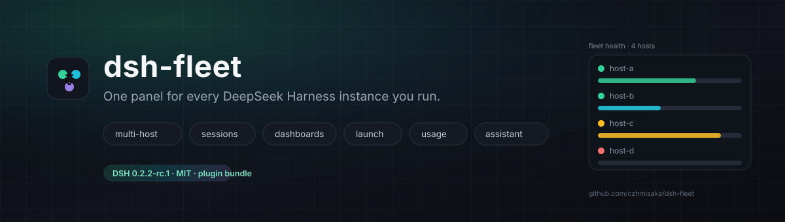
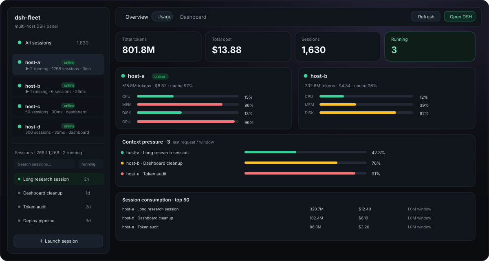
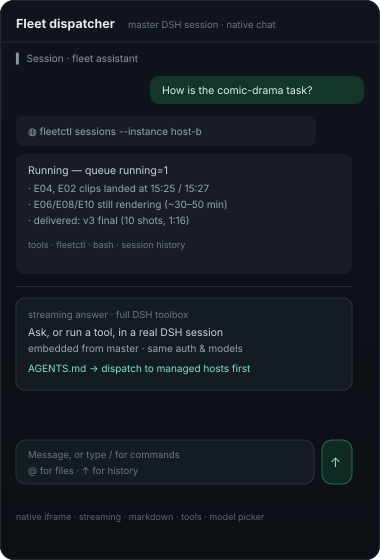
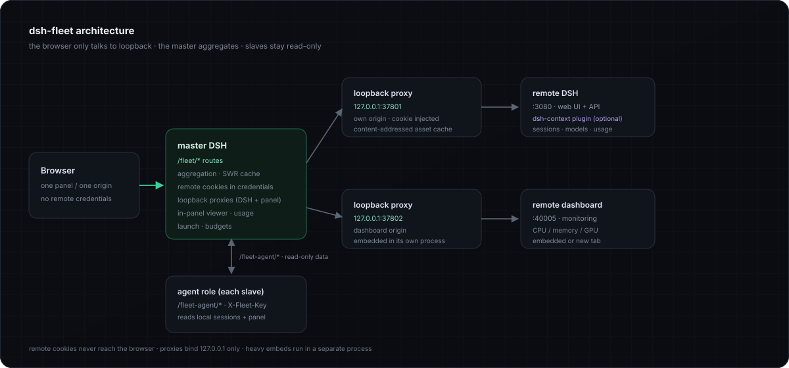

<div align="center">



**One panel for every DeepSeek Harness instance you run.**
Cross-host sessions / live dashboards / usage & context pressure / one-click launch — all inside the DSH sidebar.

[](https://github.com/deepseek-ai/deepseek-harness)
[](LICENSE)
[](https://github.com/czhmisaka/dsh-fleet)

[**Quick start**](#quick-start) · [**Features**](#features) · [**Architecture**](#architecture) · [**Config**](#configuration) · [**FAQ**](#faq) · [中文](README.md)

</div>



## Why dsh-fleet

DSH is designed around one machine and one workspace. Once your work spans several hosts, the real cost is not extra tabs — it is that **context and state get fragmented**:

- **Can't pick up where you left off**: to continue a session on another host you must remember which host it was, open its :3080, and find the session again — by then the thread is lost.
- **Can't see what's running**: which host is busy, for how long, whether it is stuck — you have to check each one.
- **Can't tell what it costs**: tokens, spend, cache hit and context occupancy live inside each host's own plugin; you only notice the bill later.
- **Slow to start**: creating a session means logging into the right host, picking a folder and a model, a dozen times a day.

dsh-fleet collects all of it into one sidebar page: **one master aggregates, every slave only reports**. Sessions, dashboards, usage, context pressure and launching live in one place, and the browser only ever talks to loopback ports on the master.

Three design rules: **don't touch the slaves** (a read-only agent is enough), **credentials never leave the master**, and **heavy pages never block the panel** (separate iframe process + background prewarm).

## Features

| | Feature | Details |
|---|---|---|
| 🖥️ | **Instance rail** | online / auth / latency / dashboard state and running count, collapsible |
| 📋 | **All sessions** | cross-host list, running first, device tags, search + running filter, subagent support |
| ⚡ | **In-panel viewer** | open a remote session in the panel; the booted app is reused, no reload per switch |
| 📊 | **Embedded dashboards** | each host's `:40005` page in an iframe with its own process, fullscreen / new-tab |
| 🚀 | **Launch session** | pick device / folder / model and create it on that host |
| 💰 | **Usage** | tokens, cost, cache hit and sessions for today / 7d / 30d by device, model and session |
| 🌡️ | **Context pressure** | window occupancy bars for running sessions (70% yellow / 85% red) + one-click new session |
| 🎯 | **Budgets** | per-device or global daily USD budget with thresholds and warnings |
| 🧭 | **DSH assistant** | Right-hand dock: one-line fleet summary, running sessions, today's usage, dispatch to the least-loaded host, resume sessions, adjust budgets. |
| 🔐 | **Secure by default** | remote cookies stay in the master credential store; proxies bind `127.0.0.1` and require a key |
| ⚙️ | **Master / agent roles** | master runs panel + proxies; agents expose read-only `/fleet-agent/*` behind a shared key |

## Quick start

### 1. master (the machine whose browser you use)

```bash
git clone https://github.com/czhmisaka/dsh-fleet.git
plugin_manager → install_bundle → pick the dsh-fleet directory
# or: cp -R dsh-fleet ~/.dsh/profiles/web/plugins/
```

Add to `~/.dsh/profiles/web/cordis.patch.yml` (or let the plugin manager write it):

```yaml
- insert:
    - id: dsh-fleet
      name: ./plugins/dsh-fleet/index.js
      config:
        role: master
        roles: [master]
        instances: []
```

Restart the DSH web process; a **Fleet** entry appears in the sidebar.

### 2. agent (every managed host)

```bash
scp -r dsh-fleet <host>:~/.dsh/profiles/web/plugins/

# npm-installed DSH needs the vendored schema library linked into the profile
ssh <host> 'mkdir -p ~/.dsh/profiles/web/node_modules/@deepseek-ai && \
  ln -sfn $(dirname $(readlink -f $(command -v dsh)))/node_modules/@deepseek-ai/schemastery \
         ~/.dsh/profiles/web/node_modules/@deepseek-ai/schemastery'

ssh <host> 'cat >> ~/.dsh/profiles/web/cordis.patch.yml <<PATCH

- insert:
    - id: dsh-fleet
      name: ./plugins/dsh-fleet/index.js
      config:
        role: agent
        roles: [agent]
        agentKey: "<shared key>"
        panelLocalUrl: http://127.0.0.1:40005
PATCH'
```

> The Usage view needs [`dsh-context`](https://github.com/bowenliang123/dsh-context) (Context Insights) on each host. Without it the view degrades to *tokens only*; install it and run a backfill to get cost / cache / context data.

### 3. Add hosts

In the panel, rail bottom → **Add** with name, DSH URL, dashboard URL, SSH and ports. Hosts with SSH configured renew their token automatically after a restart.

## DSH assistant

The right-hand dock is a collapsible **DSH assistant** that embeds a **real DSH session from the master** — streaming output, tool calls, model switching, `@` file references and Markdown are all native DSH features, not a home-made chat box.



The workspace is fixed at `~/.dsh/fleet-assistant`; `AGENTS.md` defines its behaviour:

- Inspect the fleet, then **dispatch tasks to the least-loaded online host first**; the master only coordinates and answers lightweight questions.
- Use `fleetctl` (state / running / sessions / usage / tail / dispatch / prompt) for real state and progress.
- When asked "how is that task doing", read the session history and recent output instead of guessing.

The dock header can widen the view, open the session in a new tab, or refresh. The session itself is persistent, so context survives.

## Architecture



- Every instance gets its own origin on the master (`127.0.0.1:<port>`), so localStorage/cookies are isolated.
- The remote cookie is injected by the master proxy; the browser only receives loopback URLs carrying a one-time key.
- Embedded pages are loaded via `localhost` so the browser gives them a separate process and heavy dashboards cannot freeze the panel.

## Configuration

Everything lives on the `dsh-fleet` entry, editable in **Settings → Fleet**:

```yaml
role: master
roles: [master]
agentKey: "<32-char shared key>"
instances:
  - id: host-a
    name: Display name
    dshUrl: http://192.0.2.10:3080
    panelUrl: http://192.0.2.10:40005
    ssh: user@192.0.2.10
    tokenLogPath: ~/.dsh/dsh-web.log
    dshPort: 37801
    panelPort: 37802
    agentUrl: http://192.0.2.10:3080/fleet-agent
    budgetDailyUsd: 0
pollMs: 5000
portBase: 37800
budgetDailyUsd: 0
budgetWarnPct: 80
```

## Compatibility

| Item | Requirement |
|---|---|
| DSH | tested on **0.2.2-rc.1**; bundle mechanism implies 0.2.x |
| Node | ≥ 22 |
| Browser | Chrome / Edge for iframe process isolation; Safari / Firefox should use *Open dashboard* |
| Upstream | http only |
| Optional plugin | `dsh-context` for usage / context / budget data |

## Security model

- Remote DSH cookies live only in the master's `~/.dsh/.credentials.yaml` (`dsh-fleet/<id>`).
- Proxies bind `127.0.0.1` and require a one-time key (`?k=` → HttpOnly cookie), otherwise 401.
- Agent endpoints except `ping` require `X-Fleet-Key`; all are read-only.
- SSH is used only to grep the launch token out of the slave log.
- Usage data is aggregates only (tokens / cost / models), never conversation content.

## FAQ

**Blank dashboard / spinner?** Third-party cookies are blocked; use *Open dashboard* in a new tab or allow `localhost` cookies.

**Instance shows "not authorized"?** Tokens rotate on restart. Configure SSH for automatic renewal, or paste the new token via *Reauthorize*.

**Usage shows "tokens only"?** That host lacks `dsh-context` or has an old version. Install 0.85+ and `POST /api/dsh-context/backfill`.

## Roadmap

- [x] P1 usage overview (tokens / cost / models / session ranking)
- [x] P2 context pressure + budgets
- [ ] P3 30-day history persistence, cross-host comparison, CSV export, webhook alerts

## License

MIT © czhmisaka
