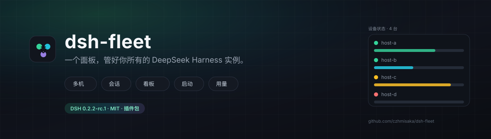
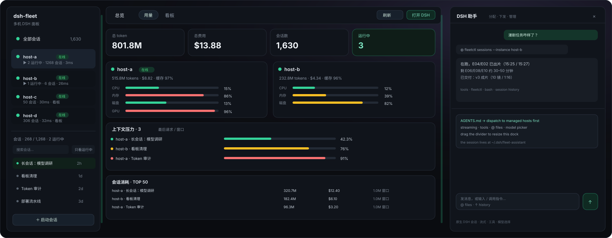
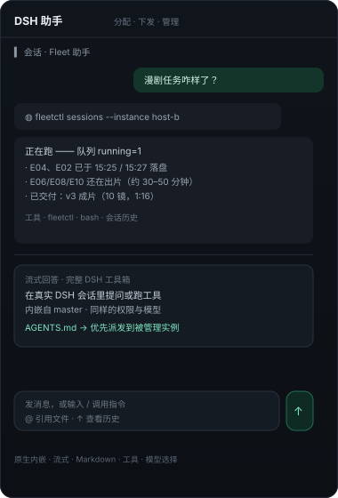
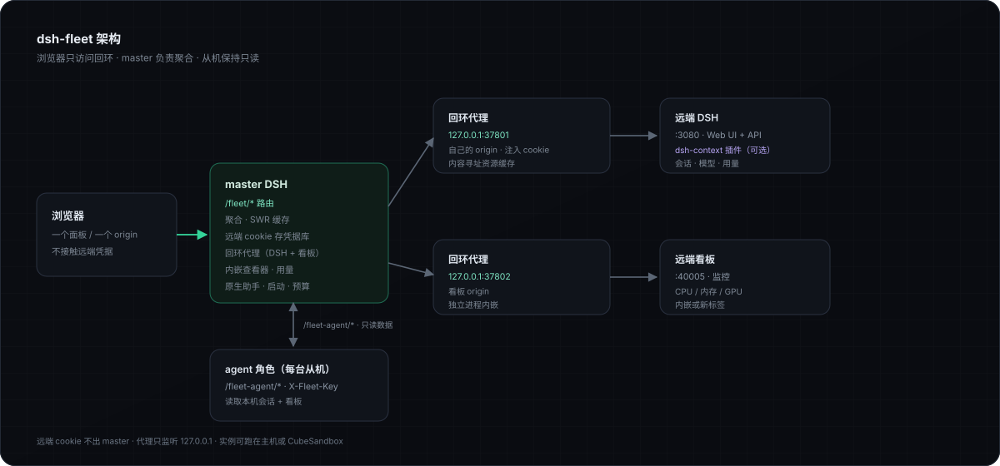

<div align="center">



**一个面板，管好你所有的 DeepSeek Harness 实例。**
多机会话 / 实时看板 / 跨设备用量与上下文压力 / 一键启动会话 —— 全部在 DSH 侧边栏里。

[](https://github.com/deepseek-ai/deepseek-harness)
[](LICENSE)
[](https://github.com/czhmisaka/dsh-fleet)
[](https://github.com/czhmisaka/dsh-fleet/pulls)

[**快速开始**](#快速开始) · [**功能**](#功能) · [**架构**](#架构) · [**配置**](#配置) · [**更新历史**](#更新历史) · [**常见问题**](#常见问题) · [English](README.en.md)

</div>



## 为什么是 dsh-fleet

DSH 是按「一台机器、一个工作区」设计的。一旦工作横跨几台机器，真正的成本不是多开几个标签页，而是**上下文和状态被切碎了**：

- **接不上**：想继续另一台机器上的会话，得先想起它在哪台、打开它的 3080、再找到那条会话——思路已经断了。
- **看不见**：哪台在跑、跑了多久、是不是卡住了，只能一台台翻。
- **算不清**：tokens、费用、缓存命中、上下文占用散落在每台机器自己的插件里，等账单出来才知道烧了多少。
- **开得慢**：新建会话要登录目标机器、选目录、挑模型，一天重复十几次。

dsh-fleet 把这些收进一个侧边栏页面：**一台 master 汇总，各从机只读上报**。会话、看板、用量、上下文压力和启动会话都在同一个地方，浏览器只访问本机的回环端口。

三条设计底线：**从机不改动**（装一个只读 agent 即可）、**凭据不出现**（远端 cookie 留在 master，浏览器拿不到）、**重页面不拖累**（内嵌页独立进程 + 后台预热）。

## 功能

| | 能力 | 说明 |
|---|---|---|
| 🖥️ | **多机实例栏** | 在线 / 授权 / 延迟 / 看板状态、运行中数量，可折叠 |
| 📋 | **全部会话** | 跨设备会话总表，运行中优先，按设备标签 + 搜索 + 只看运行中；支持子会话 |
| ⚡ | **会话内查看** | 面板内打开远端会话，复用已启动的 app，切会话不重载 |
| 📊 | **看板嵌入** | 各机 `:40005` 监控页内嵌，独立进程隔离不卡主界面，可全屏/新标签 |
| 🚀 | **启动会话** | 选设备 / 文件夹 / 模型，直接在目标机器创建并打开 |
| 💰 | **用量总览** | 今日 / 7 天 / 30 天的 tokens、费用、缓存命中、会话数；按设备、模型、会话拆解 |
| 🌡️ | **上下文压力** | 运行中会话的窗口占用条（70% 黄 / 85% 红），一键同目录新建会话 |
| 🎯 | **预算告警** | 全局/单机日预算（USD）+ 阈值，用量页横幅 + 实例卡提示 |
| 🧭 | **DSH 助手** | 右侧停靠：一句话汇总状态、列运行中、看今日消耗、把任务派发到最空闲的设备、继续会话、改预算。 |
| 🔐 | **安全默认** | 远端 cookie 只存 master 凭据库；代理只监听 `127.0.0.1`，无 key 一律 401 |
| ⚙️ | **主从角色** | master 跑面板与代理，agent 只暴露只读 `/fleet-agent/*`，共享 key 鉴权 |

## 快速开始

### 1. master（你日常用的那台）

```bash
git clone https://github.com/czhmisaka/dsh-fleet.git
plugin_manager → install_bundle → 选择 dsh-fleet 目录
# 或手动：cp -R dsh-fleet ~/.dsh/profiles/web/plugins/
```

在 `~/.dsh/profiles/web/cordis.patch.yml` 插入（或让插件管理器写入）：

```yaml
- insert:
    - id: dsh-fleet
      name: ./plugins/dsh-fleet/index.js
      config:
        role: master
        roles: [master]
        instances: []
```

重启 DSH web，侧边栏出现「多机」。

### 2. agent（每台被管理的机器）

```bash
scp -r dsh-fleet <host>:~/.dsh/profiles/web/plugins/

# npm 版 DSH 需要把内置 schema 库链进 profile
ssh <host> 'mkdir -p ~/.dsh/profiles/web/node_modules/@deepseek-ai && \
  ln -sfn $(dirname $(readlink -f $(command -v dsh)))/node_modules/@deepseek-ai/schemastery \
         ~/.dsh/profiles/web/node_modules/@deepseek-ai/schemastery'

# 追加 agent 配置并重启
ssh <host> 'cat >> ~/.dsh/profiles/web/cordis.patch.yml <<PATCH

- insert:
    - id: dsh-fleet
      name: ./plugins/dsh-fleet/index.js
      config:
        role: agent
        roles: [agent]
        agentKey: "<与 master 相同的共享密钥>"
        panelLocalUrl: http://127.0.0.1:40005
PATCH'
```

> 用量视图需要各机安装 [`dsh-context`](https://github.com/bowenliang123/dsh-context)（上下文洞察）。没有它时会自动降级为「仅 tokens」，装好并触发一次 backfill 后费用/缓存/上下文全部出现。

### 3. 加机器

打开面板 → 左栏「添加实例」填名称、DSH 地址、看板地址、SSH、端口即可；或直接改 `instances` 配置。配了 SSH 的实例会在 token 轮换后自动续期。

## DSH 助手

面板最右侧是可折叠的 **DSH 助手** —— 它不是自制的聊天框，而是**把 master 上的一个真实 DSH 会话内嵌进来**：流式输出、工具调用、模型切换、`@` 引用文件、Markdown 渲染全部是 DSH 原生能力。



会话工作区固定在 `~/.dsh/fleet-assistant`，`AGENTS.md` 规定了它的行为：

- 先看各实例状态，**优先把任务 dispatch 给最空闲的在线实例**，master 只做调度与轻量查询
- 用 `fleetctl`（state / running / sessions / usage / tail / dispatch / prompt）查真实状态、跟踪进度
- 问“某任务怎么样了”时读会话历史和最近输出，不猜

顶部按钮可以**撑宽**、**在新标签打开**或刷新；会话本身持久化，聊过的上下文都留着。

## 架构



- 每个实例在 master 上都有**独立 origin**（`127.0.0.1:<port>`），localStorage / cookie 天然隔离。
- 远端 cookie 由 master 代理注入，浏览器只拿到带一次性 key 的回环 URL。
- 内嵌页用 `localhost` 访问，浏览器给它独立进程，重看板不会卡主界面。

## 面板导览

| 视图 | 内容 |
|---|---|
| **总览** | 每台机器的 CPU / 内存 / 磁盘 / GPU 卡片 + 状态 pill + 运行中数 |
| **用量** | 全局与按设备的 tokens/费用/缓存；按模型分布；上下文压力；会话消耗 TOP 50 |
| **看板** | 当前实例的 `:40005` 内嵌，实时监控 |
| **左栏会话** | 当前设备的会话（搜索 / 运行中 / 含子会话），点开即在面板内查看 |

## 配置

所有配置都在 `dsh-fleet` 条目里，也可在 **设置 → 多机管理** 编辑：

```yaml
role: master            # master | agent
roles: [master]         # 可同时 [master, agent]
agentKey: "<32位随机串>" # 主从共享密钥
instances:
  - id: host-a
    name: 显示名
    dshUrl: http://192.0.2.10:3080
    panelUrl: http://192.0.2.10:40005
    ssh: user@192.0.2.10
    tokenLogPath: ~/.dsh/dsh-web.log
    dshPort: 37801
    panelPort: 37802
    agentUrl: http://192.0.2.10:3080/fleet-agent
    budgetDailyUsd: 0    # 单机日预算（0=用全局）
pollMs: 5000             # 健康轮询
portBase: 37800          # 代理端口起点
budgetDailyUsd: 0        # 全局日预算（USD）
budgetWarnPct: 80        # 告警阈值
```

## 兼容性

| 项目 | 要求 |
|---|---|
| DSH | **0.2.2-rc.1** 实测；使用 bundle 机制，0.2.x 预期可用 |
| Node | ≥ 22 |
| 浏览器 | Chrome / Edge（内嵌页进程隔离）；Safari / Firefox 建议用「打开看板」 |
| 上游 | 仅 http |
| 可选插件 | `dsh-context` 用于用量/上下文/预算数据 |

## 安全模型

- 远端 DSH cookie 只存在 master 的 `~/.dsh/.credentials.yaml`（`dsh-fleet/<id>`），不下发浏览器、不写日志。
- 代理监听 `127.0.0.1`，必须携带一次性 key（`?k=` → HttpOnly cookie），否则 401。
- agent 接口除 `ping` 外都要求 `X-Fleet-Key`，只读。
- SSH 只用于从从机日志 grep token / 续期 cookie。
- 用量数据只取 token/费用/模型等聚合值，不取会话正文。

## 常见问题

**看板空白 / 一直转圈？** 浏览器禁用了第三方 cookie 时内嵌页会失败，用右上「打开看板」新标签，或允许 `localhost` cookie。

**实例显示未授权？** token 随从机重启轮换。配好 SSH 会自动续；否则点「重新授权」粘贴新 token。

**用量显示「仅 tokens」？** 该机器没装 `dsh-context` 或版本太旧。装 0.85+ 并 `POST /api/dsh-context/backfill` 后恢复。

**spark/GPU 机器没有开机自启？** 这是机器本身的服务管理，不在插件范围内；恢复后面板会自动重连。

## Roadmap

- [x] P1 多机用量总览（tokens / 费用 / 模型 / 会话榜）
- [x] P2 上下文压力 + 预算告警
- [ ] P3 30 天历史落盘、跨机对比、CSV 导出、webhook 通知
- [ ] 更多实例健康指标与自动降级策略

## 更新历史

完整记录见 **[CHANGELOG.md](CHANGELOG.md)**（每个版本的变更、修复与升级提示）。最近版本快速索引：

| 版本 | 日期 | 主题 |
|---|---|---|
| [v0.5.1](CHANGELOG.md#v0-5-1) | 2026-11-18 | 左右侧边栏可拖动调宽 |
| [v0.5.0](CHANGELOG.md#v0-5-0) | 2026-11-18 | 右侧助手改为内嵌 master 原生 DSH 会话 |
| [v0.4.0](CHANGELOG.md#v0-4-0) | 2026-11-18 | 助手升级为真实 DSH 会话（fleetctl 派发） |
| [v0.3.0](CHANGELOG.md#v0-3-0) | 2026-11-18 | 右侧可折叠 DSH 助手（规则版） |
| [v0.2.2](CHANGELOG.md#v0-2-2) | 2026-11-18 | 用量范围数字与部分费用修复 |
| [v0.2.1](CHANGELOG.md#v0-2-1) | 2026-11-18 | 上下文压力 + 预算告警 |
| [v0.2.0](CHANGELOG.md#v0-2-0) | 2026-11-18 | 多机用量视图 |
| [v0.1.11 及更早](CHANGELOG.md#v0-1-11) | 2026-11-18 | 首个公开版本与早期迭代 |

## 标准测试环境

需要一套可重复的 master + agent + CubeSandbox 多机环境时，用仓库里的 `test-env/`：

```bash
node test-env/up.mjs     # 建 CubeSandbox 实例 + 注册进 fleet
node test-env/smoke.mjs  # 状态/会话/用量/助手接口验收
node test-env/down.mjs   # 注销 + 销毁
```

拓扑与验收清单见 [test-env/README.md](test-env/README.md)，落地记录见 [test-env/RECORD.md](test-env/RECORD.md)。

## 贡献

欢迎 Issue / PR。改 client 后请用真实 Chrome 验证（Playwright `channel: 'chrome'`），纯 Chromium 没有跨站进程隔离，测不出内嵌页真实性能。

## License

MIT © czhmisaka
